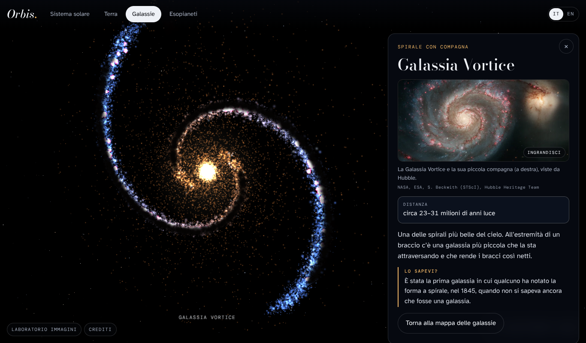

# Orbis

Un'app per esplorare l'universo e la Terra: il sistema solare in 3D, le galassie da vedere da vicino, i pianeti scoperti intorno ad altre stelle, e poi le discese verticali nell'oceano più profondo, nella foresta amazzonica e nelle foreste del Madagascar, incontrando creature che quasi nessuno conosce. Ogni giorno, due nuove curiosità sullo spazio e sulla Terra.

Idea di Olivia Dinu, costruita con Claude. Versione del 18 ottobre 2026.

## Come aprirla

- **Come app sul telefono:** apri [dinuolivia-a11y.github.io/Orbis](https://dinuolivia-a11y.github.io/Orbis/) e tocca **Installa**, in basso a sinistra.
  - Android, con Chrome: si apre la finestra per installarla. Se non compare, menu ⋮ → **Installa app**.
  - iPhone, con Safari: tocca i tre puntini ••• accanto all'indirizzo → **Condividi** → **Aggiungi alla schermata Home**, lascia acceso **Apri come app web** e tocca **Aggiungi**. Sugli iPhone meno recenti il tasto Condividi è già nella barra in basso.
  - Orbis compare tra le app con la sua icona e si apre a tutto schermo. Dopo la prima apertura funziona anche senza internet. Le foto grandi delle galassie restano sul telefono dopo averle aperte una volta.
- **Sul computer:** scarica `Orbis.html` e aprilo con un doppio clic. Serve internet, perché la grafica 3D e i caratteri si scaricano all'apertura. In questa versione le foto delle galassie sono in formato ridotto.
- **Sul telefono:** meglio usare il link dell'app su Claude.
- **Per metterla online:** la cartella `app/` è la versione installabile, con tutto dentro: grafica 3D, caratteri, icone e foto grandi. Si può pubblicare così com'è su qualsiasi sito statico. Il ramo `gh-pages` ne contiene una copia, ed è quella pubblicata su GitHub Pages: per aggiornare il sito basta caricare lì la nuova versione di `app/`. Le app già installate si aggiornano da sole alla prima apertura con internet.

Comandi:

- **Un dito** (o il mouse) gira tutto liberamente, anche sottosopra e da sotto.
- **Due dita:** allargandole ingrandisci proprio nel punto che tocchi; spostandole insieme scorri la vista a destra, a sinistra, su e giù. Col mouse: rotella per ingrandire dove punti, tasto destro per scorrere. Vale per il sistema solare e le galassie; Terra ed esopianeti si girano e si ingrandiscono al centro.
- Se ingrandisci o scorri fino a un pianeta, la vista ci si centra e lo segue mentre gira intorno al Sole.
- Tocca un pianeta, una galassia o un luogo sulla Terra per aprirne la scheda. La **×** nasconde solo il testo: resti dove sei, con una barretta col nome e il tasto **Scheda** per riaprirlo. La lente con il meno riporta alla vista d'insieme.
- Se ti perdi, tocca **Vista d'insieme** in alto a destra, oppure di nuovo la sezione in cui sei.
- In alto a destra si passa da italiano a inglese.
- Quando c'è una nuova versione e l'app è già aperta, compare **Aggiorna**.

## Cosa c'è dentro

- **Sistema solare:** Sole, 8 pianeti e la Luna con le mappe reali basate sui dati NASA, e un cielo stellato più vivo.
- **Galassie:** 12 galassie costruite stella per stella, da 1.400 a 70.000 stelle ciascuna, con bracci, polveri e nebulose. Tocchi una galassia e ci voli vicino, poi zoomi fin dentro. Nella scheda c'è la **foto vera** fatta da Hubble, Webb o dai telescopi ESO, da ingrandire a tutto schermo. Nella Via Lattea un segno mostra dove si trova il Sole.
- **Esopianeti:** 13 pianeti, comprese le scoperte del 2026, con ricerca e filtri.
- **Terra:** giorno e notte con le luci delle città, nuvole e atmosfera. 3 luoghi esplorabili e 13 segnati come "presto".
- **Discese:**
  - Oceano: da 0 a 10.935 m, 17 creature.
  - Amazzonia: dagli 88,5 m dell'albero più alto fino a sotto terra, 12 creature.
  - Madagascar: dalla chioma della foresta pluviale alle tane nella terra rossa, 10 creature.
- **Curiosità del giorno:** 31 sullo spazio e 30 sulla Terra, ognuna con la spiegazione del perché. Si aprono da sole la prima volta di ogni giorno e da "Lo sapevi?" in basso a destra. "Mostramelo" porta nel punto dell'app di cui parla la curiosità.
- **Laboratorio immagini:** un prompt per ognuna delle 39 creature.

## Come lavoriamo

1. Claude sceglie e verifica le creature di ogni zona, con le fonti, e scrive i prompt delle immagini.
2. Olivia genera le immagini con Grok o ChatGPT usando quei prompt.
3. Claude controlla ogni immagine e la inserisce nell'app.

Una zona alla volta, finita prima di passare alla successiva.

## Cartelle

| Percorso | Cosa contiene |
|---|---|
| `Orbis.html` | L'app in un solo file, da aprire con doppio clic. |
| `app/` | La versione installabile: pagina, mappe dei pianeti (`tex/`), foto delle galassie (`photos/`), icone (`icons/`), three.js (`vendor/`), caratteri (`fonts/`), `manifest.webmanifest` e `sw.js` per l'uso senza internet. |
| `icona/` | Le tre proposte per l'icona dell'app. In uso c'è la 1, la Terra con l'orbita dorata. |
| `docs/prompt-creature.md` | I 39 prompt per le immagini delle creature. |
| `docs/verifica-database-grok.md` | La verifica del database di creature preparato con Grok. |
| `anteprime/` | Schermate dell'app. |

## Com'è fatta

- Una sola pagina HTML con CSS e JavaScript, senza server.
- Grafica 3D con [three.js](https://threejs.org) 0.170: `Orbis.html` lo carica da CDN, la versione in `app/` lo ha dentro `vendor/`.
- La versione in `app/` è una PWA: `manifest.webmanifest` dà nome, colori e icone, `sw.js` salva la pagina, le mappe e le foto piccole al primo avvio, così Orbis si apre anche senza internet.
- L'icona è disegnata con lo stesso motore 3D dell'app e le mappe vere della Terra: giorno e notte con le luci delle città, nuvole, atmosfera e un'orbita dorata.
- La Terra ha uno shader scritto a mano per giorno, notte e riflessi sull'oceano. Gli esopianeti sono generati con un rumore procedurale.
- Le galassie sono nuvole di punti generate dal programma: bracci a spirale logaritmica, rigonfiamento centrale, regioni rosa di formazione stellare e polveri scure. Ognuna è orientata con l'inclinazione con cui la vediamo dalla Terra.
- Tutti i contenuti, in italiano e inglese, sono in oggetti dentro la pagina: `PLANETS`, `GALAXIES`, `GAL3D`, `GAL_PHOTOS`, `EXO`, `DIVES`, `HOTSPOTS`, `CUR_SPACE`, `CUR_EARTH`.
- Per aggiungere l'immagine di una creatura: metti il file in `app/img/` e aggiungi una riga nell'oggetto `IMAGES`, per esempio `indri: "img/indri.jpg"`.

## Cosa manca ancora

1. Le immagini delle creature: 6 su 39 sono pronte (Madagascar). Il controllo è in `docs/controllo-immagini.md`; per le altre c'è ancora una lettera provvisoria.
2. I 13 luoghi segnati come "presto" sul globo, da verificare e aprire uno alla volta.
3. La foto del giorno della NASA (APOD), quando l'app avrà un suo sito.
4. Il Laboratorio immagini va tolto prima di pubblicare l'app.

## Crediti

- Mappe di Sole, pianeti e Luna: [Solar System Scope](https://www.solarsystemscope.com/textures/), CC BY 4.0, basate su dati NASA.
- Mappe della Terra: NASA Visible Earth / Blue Marble, tramite [three-globe](https://github.com/vasturiano/three-globe).
- Foto delle galassie, CC BY 4.0:
  - [ESA/Hubble](https://esahubble.org/copyright/): Andromeda, Triangolo, Girandola, Vortice.
  - [ESA/Webb](https://esawebb.org/copyright/): Sombrero, MoM-z14.
  - [ESO](https://www.eso.org/public/outreach/copyright/): Via Lattea (S. Brunier), Nubi di Magellano (Y. Beletsky; VISTA VMC), Centaurus A.
  - Buco nero di M87: EHT Collaboration.
  - I nomi completi degli autori sono sotto ogni foto nell'app.
- Grafica 3D: three.js, licenza MIT, inclusa in `app/vendor/`. Caratteri: Bodoni Moda, Atkinson Hyperlegible e DM Mono, SIL Open Font License.
- Dati: [NASA Exoplanet Archive](https://exoplanetarchive.ipac.caltech.edu/), MBARI, NOAA Ocean Exploration, FishBase, IUCN, Università delle Hawaii, Senckenberg, Durrell e WWT, e le pubblicazioni scientifiche citate in `docs/`.

Nel sistema solare distanze e dimensioni non sono in scala. Le galassie in 3D e gli esopianeti sono ricostruzioni: le foto vere sono nelle schede delle galassie.
