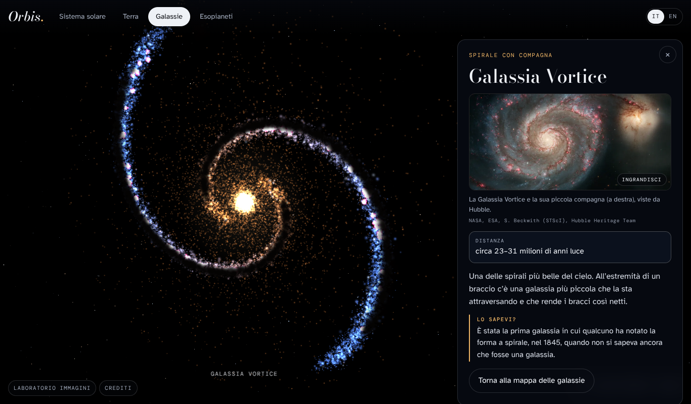

# Orbis

Un'app per esplorare l'universo e la Terra: il sistema solare in 3D, le galassie da vedere da vicino, i pianeti scoperti intorno ad altre stelle, e poi le discese verticali in 12 luoghi della Terra, dall'oceano più profondo alla cima dell'Everest, incontrando 131 creature, molte delle quali quasi nessuno conosce. Ogni giorno, due nuove curiosità sullo spazio e sulla Terra.

Idea di Olivia Dinu, costruita con Claude. Versione del 3 novembre 2026.

## Come aprirla

- **Come app sul telefono:** apri [dinuolivia-a11y.github.io/Orbis](https://dinuolivia-a11y.github.io/Orbis/) e tocca **Installa**, in basso a sinistra.
  - Android, con Chrome: si apre la finestra per installarla. Se non compare, menu ⋮ → **Installa app**.
  - iPhone, con Safari: tocca i tre puntini ••• accanto all'indirizzo → **Condividi** → **Aggiungi alla schermata Home**, lascia acceso **Apri come app web** e tocca **Aggiungi**. Sugli iPhone meno recenti il tasto Condividi è già nella barra in basso.
  - Orbis compare tra le app con la sua icona e si apre a tutto schermo. Dopo la prima apertura funziona anche senza internet. Le foto grandi delle galassie restano sul telefono dopo averle aperte una volta.
- **Sul computer:** scarica `Orbis.html` e aprilo con un doppio clic. Serve internet, perché la grafica 3D e i caratteri si scaricano all'apertura. In questa versione le foto delle galassie sono in formato ridotto.
- **Sul telefono:** meglio usare il link dell'app su Claude.
- **Per metterla online:** la cartella `app/` è la versione installabile, con tutto dentro: grafica 3D, caratteri, icone e foto grandi. Si può pubblicare così com'è su qualsiasi sito statico. Il ramo `gh-pages` ne contiene una copia, ed è quella pubblicata su GitHub Pages: per aggiornare il sito basta caricare lì la nuova versione di `app/`. Le app già installate si aggiornano da sole alla prima apertura con internet.

Comandi:

- **Un dito** (o il mouse) gira tutto liberamente, anche sottosopra e da sotto.
- **Due dita:** allargandole ingrandisci proprio nel punto che tocchi; spostandole insieme scorri la vista a destra, a sinistra, su e giù. Col mouse: rotella per ingrandire dove punti, tasto destro per scorrere. Vale per il sistema solare e le galassie; Terra ed esopianeti si girano e si ingrandiscono al centro.
- Se ingrandisci o scorri fino a un pianeta, la vista ci si centra e lo segue mentre gira intorno al Sole.
- Tocca un pianeta, una galassia o un luogo sulla Terra per aprirne la scheda. La **×** nasconde solo il testo: resti dove sei, con una barretta col nome e il tasto **Scheda** per riaprirlo. La lente con il meno riporta alla vista d'insieme.
- Se ti perdi, tocca **Vista d'insieme** in alto a destra, oppure di nuovo la sezione in cui sei.
- In alto a destra si passa da italiano a inglese.
- Quando c'è una nuova versione e l'app è già aperta, compare **Aggiorna**.

## Cosa c'è dentro

- **Sistema solare:** Sole, 8 pianeti e la Luna con le mappe reali basate sui dati NASA, e un cielo stellato più vivo.
- **Galassie:** 12 galassie costruite stella per stella, da 1.400 a 70.000 stelle ciascuna, con bracci, polveri e nebulose. Tocchi una galassia e ci voli vicino, poi zoomi fin dentro. Nella scheda c'è la **foto vera** fatta da Hubble, Webb o dai telescopi ESO, da ingrandire a tutto schermo. Nella Via Lattea un segno mostra dove si trova il Sole.
- **Esopianeti:** 13 pianeti, comprese le scoperte del 2026, con ricerca e filtri. Per Kepler-16 b, il pianeta con due soli, si vede tutto il sistema: le due stelle che si girano intorno e il pianeta che fa il giro di entrambe, con le distanze in proporzione.
- **Terra:** giorno e notte con le luci delle città, nuvole e atmosfera. 12 luoghi esplorabili e 5 segnati come "presto".
- **Discese:**
  - Oceano: da 0 a 10.935 m, 17 creature.
  - Amazzonia: dagli 88,5 m dell'albero più alto fino a sotto terra, 12 creature.
  - Madagascar: dalla chioma della foresta pluviale alle tane nella terra rossa, 10 creature.
  - Himalaya: dalla cima dell'Everest alle foreste di rododendri, con l'ossigeno che cambia, 12 creature.
  - Nuova Zelanda: dalle Alpi del Sud al mare, 9 creature.
  - Tundra artica: dal cielo alle gallerie sotto la neve, con la temperatura d'inverno, 10 creature.
  - Antartide: dal cielo sopra il ghiaccio a 600 m sotto il mare, 10 creature.
  - Tian Shan: dalle Montagne Celesti ai boschi di abeti, 7 creature.
  - Ande: dal vulcano Llullaillaco alla foresta delle nuvole, 7 creature.
  - Sahara: dall'aria rovente alle tane sotto la sabbia, con la temperatura, 7 creature.
  - Grande Barriera Corallina: dal cielo sopra un’isola di corallo a 600 m lungo la parete del Mar dei Coralli, con la luce del sole che si spegne, 16 creature. Lo sfondo si muove come l’acqua e si sente il mare; il tasto con l’altoparlante spegne il suono.
  - Ghati occidentali: dalla vetta dell’Anamudi ai fiumi, tra prati fioriti, foreste nelle nuvole e la pioggia del monsone, con l’ossigeno che cambia, 14 creature.
- **Curiosità del giorno:** 31 sullo spazio e 30 sulla Terra, ognuna con la spiegazione del perché. Si aprono da sole la prima volta di ogni giorno e da "Lo sapevi?" in basso a destra. "Mostramelo" porta nel punto dell'app di cui parla la curiosità.
- **Mini lezioni di scienza:** la quinta sezione, «Lezioni». 44 lezioni brevi in sette materie (particelle e quanti, fisica, chimica, vita, spazio, Terra, numeri e idee), ognuna con «Prova tu» e «Lo sapevi?», 9 esperimenti da toccare e 9 disegni. Si filtrano per materia, si cercano, e quelle lette vengono segnate. L’elenco completo è in `docs/lezioni.md`.
- **Foto vere:** 62 creature hanno una foto vera, scattata da naturalisti e ricercatori, con licenza libera. Sulla scheda c'è scritto "Foto", l'autore e la licenza; ingrandendola c'è il link all'originale.
- **Laboratorio immagini:** un prompt per ognuna delle 131 creature, con lo stato «foto vera», «pronta» o «da fare».

## Come lavoriamo

1. Claude sceglie e verifica le creature di ogni zona, con le fonti, e scrive i prompt delle immagini.
2. Per ogni creatura Claude cerca prima una foto vera con licenza libera (iNaturalist, NOAA Ocean Exploration): se c'è, la verifica e la mette con il nome dell'autore.
3. Per le creature senza foto libera, Olivia genera l'immagine con ChatGPT o Grok usando quei prompt; Claude la controlla e la inserisce nell'app.

Una zona alla volta, finita prima di passare alla successiva.

## Cartelle

| Percorso | Cosa contiene |
|---|---|
| `Orbis.html` | L'app in un solo file, da aprire con doppio clic. |
| `app/` | La versione installabile: pagina, mappe dei pianeti (`tex/`), foto delle galassie (`photos/`), icone (`icons/`), three.js (`vendor/`), caratteri (`fonts/`), `manifest.webmanifest` e `sw.js` per l'uso senza internet. |
| `icona/` | Le tre proposte per l'icona dell'app. In uso c'è la 1, la Terra con l'orbita dorata. |
| `docs/prompt-creature.md` | I prompt per le immagini di tutte le 131 creature. |
| `docs/verifica-database-grok.md` | La verifica del database di creature preparato con Grok. |
| `docs/foto-creature.md` | Le 62 foto vere delle creature: autore, licenza e link all'originale. |
| `docs/controllo-immagini.md` | Il controllo delle 53 illustrazioni fatte con Grok. |
| `docs/barriera-corallina.md` | La Grande Barriera Corallina: le 16 creature, le curiosità e le fonti scientifiche. |
| `docs/ghati-occidentali.md` | I Ghati occidentali: le 14 creature, le curiosità e le fonti scientifiche. |
| `docs/lezioni.md` | Le mini lezioni di scienza: elenco, esperimenti e come aggiungerne di nuove. |
| `sorgenti/` | I file da cui si costruisce l’app: la pagina, le lezioni (`lezioni/`) e gli script per costruire la versione installabile e il file unico. |
| `docs/illustrazioni-link.md` | Il controllo delle 13 illustrazioni fatte con Link (ChatGPT) e delle 3 foto vere trovate tra i suoi riferimenti. |
| `anteprime/` | Schermate dell'app. |

## Com'è fatta

- Una sola pagina HTML con CSS e JavaScript, senza server.
- Sfondi vivi in ogni discesa, disegnati dal programma dietro le schede: nuvole che passano, foglie che ondeggiano e cadono, tronchi, terriccio con sassolini e radici sotto terra, dune e sabbia al vento nel Sahara, neve al vento e scintillii di ghiaccio, creste e nebbia in montagna, la pioggia del monsone nelle foreste dei Ghati. L’oceano ha l’acqua viva e il suono della Barriera.
- Nella Barriera Corallina la luce che danza, i raggi di sole e le bollicine sono disegnati dal programma, e anche il suono è creato al momento con Web Audio, senza file audio: le onde sopra il mare, un rumore ovattato con le bollicine sotto, sempre più cupo man mano che si scende.
- Grafica 3D con [three.js](https://threejs.org) 0.170: `Orbis.html` lo carica da CDN, la versione in `app/` lo ha dentro `vendor/`.
- La versione in `app/` è una PWA: `manifest.webmanifest` dà nome, colori e icone, `sw.js` salva la pagina, le mappe e le foto piccole al primo avvio, così Orbis si apre anche senza internet.
- L'icona è disegnata con lo stesso motore 3D dell'app e le mappe vere della Terra: giorno e notte con le luci delle città, nuvole, atmosfera e un'orbita dorata.
- La Terra ha uno shader scritto a mano per giorno, notte e riflessi sull'oceano. Gli esopianeti sono generati con un rumore procedurale.
- Le galassie sono nuvole di punti generate dal programma: bracci a spirale logaritmica, rigonfiamento centrale, regioni rosa di formazione stellare e polveri scure. Ognuna è orientata con l'inclinazione con cui la vediamo dalla Terra.
- Tutti i contenuti, in italiano e inglese, sono in oggetti dentro la pagina: `PLANETS`, `GALAXIES`, `GAL3D`, `GAL_PHOTOS`, `EXO`, `DIVES`, `HOTSPOTS`, `CUR_SPACE`, `CUR_EARTH`.
- Per aggiungere l'immagine di una creatura: metti il file in `app/img/` e aggiungi una riga nell'oggetto `IMAGES`, per esempio `indri: "img/indri.webp"`. Se è una foto vera, aggiungi anche autore, licenza e link nell'oggetto `CREATURE_PHOTOS`: la scheda mostra "Foto · autore · licenza" e la pagina Crediti la elenca.

## Cosa manca ancora

1. I 5 luoghi ancora segnati come "presto" sul globo: Atacama, Namib, Appalachi, Ghiacciai della Patagonia e Altopiano etiope.
2. Le immagini di 3 creature, da fare con Link: Medusa Irukandji e Pesce torcia della Barriera Corallina, Barbo di Denison dei Ghati occidentali. I prompt sono in `docs/prompt-creature.md` e nel Laboratorio immagini.
3. La foto del giorno della NASA (APOD), quando l'app avrà un suo sito.
4. Il Laboratorio immagini va tolto prima di pubblicare l'app.

## Crediti

- Mappe di Sole, pianeti e Luna: [Solar System Scope](https://www.solarsystemscope.com/textures/), CC BY 4.0, basate su dati NASA.
- Mappe della Terra: NASA Visible Earth / Blue Marble, tramite [three-globe](https://github.com/vasturiano/three-globe).
- Foto delle galassie, CC BY 4.0:
  - [ESA/Hubble](https://esahubble.org/copyright/): Andromeda, Triangolo, Girandola, Vortice.
  - [ESA/Webb](https://esawebb.org/copyright/): Sombrero, MoM-z14.
  - [ESO](https://www.eso.org/public/outreach/copyright/): Via Lattea (S. Brunier), Nubi di Magellano (Y. Beletsky; VISTA VMC), Centaurus A.
  - Buco nero di M87: EHT Collaboration.
  - I nomi completi degli autori sono sotto ogni foto nell'app.
- Foto delle creature: 55 da [iNaturalist](https://www.inaturalist.org) (CC0, CC BY, CC BY-SA), 4 da [NOAA Ocean Exploration](https://oceanexplorer.noaa.gov) (pubblico dominio), 2 da Wikimedia Commons (CC0, CC BY-SA) e 1 da [Ifremer](https://image.ifremer.fr) (CC BY). Autori e link in `docs/foto-creature.md`. Le altre 66 creature hanno illustrazioni create con Grok e ChatGPT e controllate da Claude. Tre creature, due della Barriera e una dei Ghati, aspettano ancora la loro immagine.
- Grafica 3D: three.js, licenza MIT, inclusa in `app/vendor/`. Caratteri: Bodoni Moda, Atkinson Hyperlegible e DM Mono, SIL Open Font License.
- Dati: [NASA Exoplanet Archive](https://exoplanetarchive.ipac.caltech.edu/), MBARI, NOAA Ocean Exploration, FishBase, IUCN, Università delle Hawaii, Senckenberg, Durrell e WWT, e le pubblicazioni scientifiche citate in `docs/`.

Nel sistema solare distanze e dimensioni non sono in scala. Le galassie in 3D e gli esopianeti sono ricostruzioni: le foto vere sono nelle schede delle galassie.
